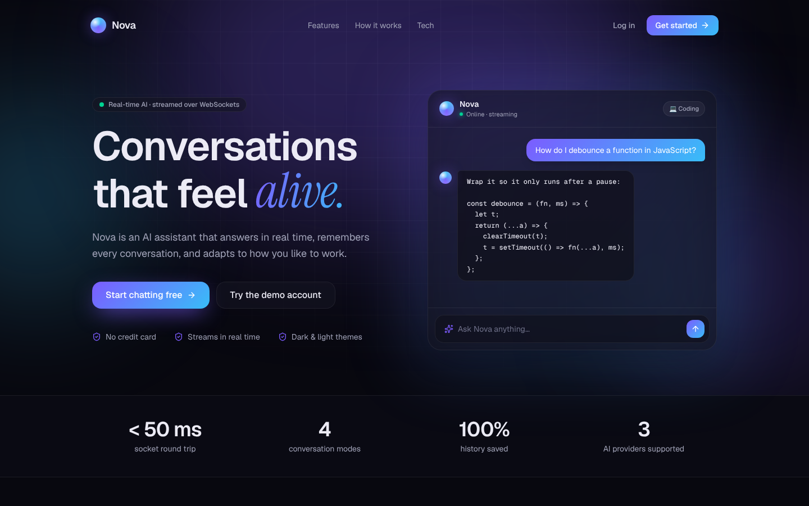
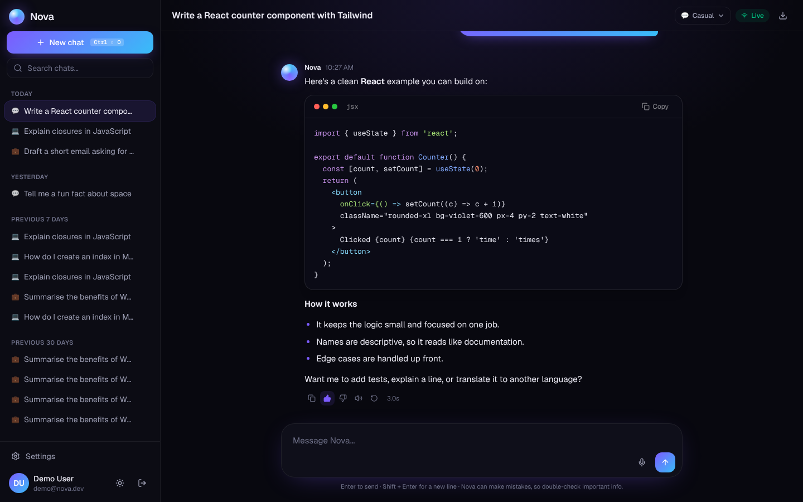
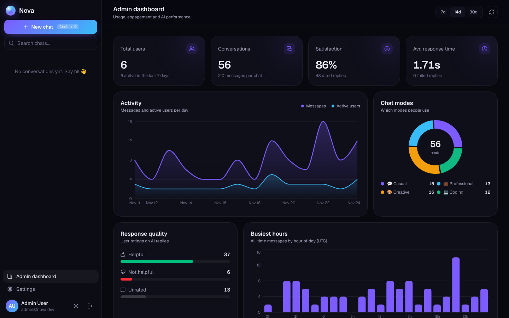
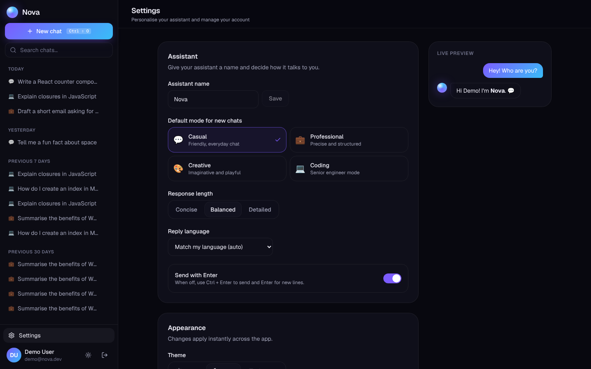
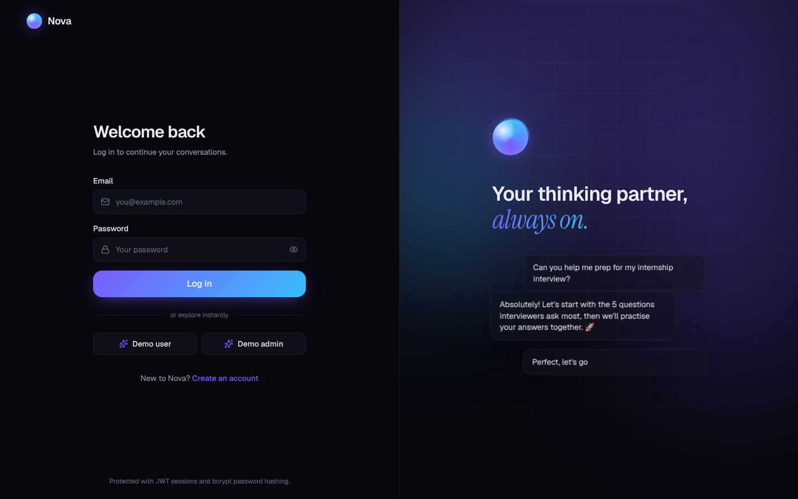
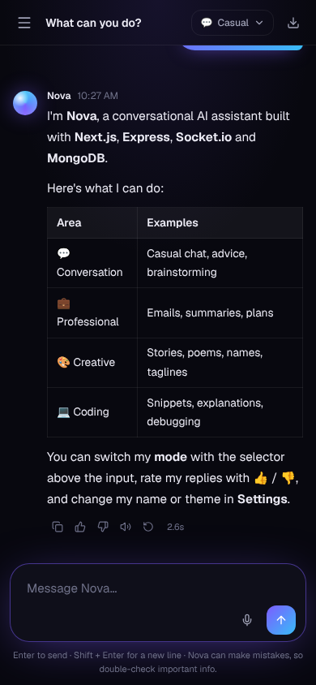

<div align="center">

# Nova · AI Chatbot

**A full-stack, real-time AI chatbot.** Answers stream in word by word over WebSockets, every conversation is saved, and each user can make the assistant their own.

Next.js · Tailwind CSS · Node.js · Express · Socket.io · MongoDB · JWT · Claude / OpenAI

**Live demo: [nova-chatbot-two.vercel.app](https://nova-chatbot-two.vercel.app)** · demo login `demo@nova.dev` / `Password123`

[](https://github.com/rohitsingh83/ai-chatbot/actions/workflows/ci.yml)



</div>

---

## Contents

- [Features](#features)
- [Screenshots](#screenshots)
- [Tech stack](#tech-stack)
- [Architecture](#architecture)
- [Quick start](#quick-start)
- [Configuration](#configuration)
- [Testing](#testing)
- [Deployment](#deployment)
- [API reference](docs/API.md)
- [Project timeline](#project-timeline-how-the-brief-maps-to-the-code)
- [Future enhancements](#future-enhancements)

## Features

| | Feature | Details |
| --- | --- | --- |
| 🔐 | **User authentication** | Sign up / log in with JWT. Passwords hashed with bcrypt, password strength meter, sessions restored on reload, automatic logout when a token expires. Changing your password signs out every other device, and **Sign out other devices** revokes all old sessions instantly (token versioning, open sockets are disconnected). |
| 💬 | **Chat interface** | Responsive Tailwind UI with Markdown, tables and syntax-highlighted code blocks (with copy buttons), auto-growing input, suggestion cards, scroll-to-latest, keyboard shortcuts. |
| ⚡ | **Real-time streaming** | Socket.io streams each token as it is generated. A "thinking" state, a **Stop** button that keeps the partial answer, **Regenerate**, and live sync across every open tab. Falls back to plain HTTP if WebSockets are unavailable. |
| 🧠 | **AI-powered responses** | Pluggable providers: **Vercel AI Gateway** (Claude, GPT, Gemini and more; on Vercel it needs no API key), **Anthropic Claude**, **OpenAI** (or any OpenAI-compatible API such as Groq, OpenRouter or Ollama), and an offline **demo model** so the whole app works with no API key. The live demo answers with Claude Haiku 5.5 through AI Gateway. |
| 🗂️ | **Chat history** | Conversations and messages stored in MongoDB with indexes. Sidebar grouped by Today / Yesterday / Previous 7 days, full-text search across titles *and* message content, rename, pin, delete, export to Markdown. Titles are generated from the first message. |
| 🎨 | **Personalisation** | Rename the assistant, light / dark / system theme, five accent colours, default chat mode, reply language, response length, and "send on Enter". Changes apply instantly. |
| 🧩 | **Custom AI tuning** | Personal **custom instructions** ("I'm a CS student, explain with Java examples") that are added to every conversation's system prompt. |
| 🌐 | **Multilingual** | Answer in any language, and **translate any reply** into 11 languages (English, Hindi, Spanish, French, German, Japanese, Chinese, Arabic, Portuguese, Bengali, Tamil) with one click. Translations are cached. |
| 📅 | **Google Calendar** | **Add to Google Calendar** on any reply turns a plan or reminder into a pre-filled calendar event. |
| 🏷️ | **Chat categories** | Casual, Professional, Creative and Coding modes, each changing the assistant's tone and format. Switch mode at any time. |
| 👍 | **Ratings & feedback** | Thumbs up / down on any reply, with quick-pick reasons and written feedback for bad answers. |
| 📊 | **Admin panel & analytics** | KPIs (users, active users, conversations, satisfaction, average response time, failed replies), activity chart, busiest hours, chat-mode split, rating breakdown, most active users, recent feedback, recent user activity feed, system status (provider, storage, online users, cache hit rate, uptime) and user role management. Auto-refreshes every 30 s. |
| 🎙️ | **Voice** | Dictate messages with the microphone (Web Speech API) and have replies read aloud. |
| 🛡️ | **Security & performance** | Helmet, CORS allow-list, zod validation on every input, per-user and per-IP rate limiting (HTTP *and* sockets), ownership checks on every chat, LRU response cache for repeated questions, AI timeouts with one automatic retry, compression and DB indexes. |

## Screenshots

| Chat (dark) | Admin dashboard |
| --- | --- |
|  |  |
| **Settings** | **Login** |
|  |  |

<p align="center"></p>

## Tech stack

| Technology | Purpose |
| --- | --- |
| **Next.js 16** (App Router, React 19) | Frontend framework |
| **Tailwind CSS 4** | Styling, theming (CSS variables for light/dark and accent colours) |
| **Motion** | Animations and micro-interactions |
| **Recharts** | Admin analytics charts |
| **react-markdown + highlight.js** | Rich message rendering |
| **Node.js + Express 5** | REST API |
| **Socket.io** | Real-time streaming and multi-tab sync |
| **MongoDB + Mongoose** | Users, conversations and messages |
| **JWT + bcrypt** | Authentication |
| **zod, Helmet, express-rate-limit** | Validation and security |
| **Claude / OpenAI APIs** | AI responses (streamed via Server-Sent Events) |

## Architecture

```
ai-chatbot/
├── frontend/                 Next.js app
│   └── src/
│       ├── app/              pages: landing, (auth)/login + signup, (app)/chat, settings, admin
│       ├── components/       chat/, admin/, shell/ (sidebar, layout), landing/, ui/
│       ├── lib/              auth + chat context (Socket.io client, optimistic updates), theming
│       ├── services/         api.ts: typed REST client
│       └── utils/            types, constants, formatting
│
├── backend/                  Express + Socket.io API
│   ├── src/
│   │   ├── routes/           auth, conversations, admin
│   │   ├── controllers/      request handlers
│   │   ├── models/           Mongoose schemas (User, Conversation, Message)
│   │   ├── middleware/       JWT auth, zod validation, rate limiting, errors
│   │   ├── services/         aiService (prompting, caching, retries) + providers/, chatService
│   │   ├── sockets/          real-time chat events and presence
│   │   ├── store/            MongoDB store + zero-config local store (same interface)
│   │   ├── config/           environment
│   │   └── scripts/          demo data seeding
│   └── tests/                API, AI service and Socket.io tests (node:test + supertest)
│
└── docs/                     API reference and screenshots
```

**How a message flows**

```
Browser ──chat:send──▶ Socket.io ──▶ chatService ──▶ save user message (MongoDB)
                                         │
                                         ▼
                                     aiService ──▶ cache hit? replay : stream from Claude / OpenAI / demo
                                         │
Browser ◀──chat:token (×N)───────────────┤   (every open tab of that user)
Browser ◀──chat:done─────────── save assistant reply with latency, provider, cache flag
```

## Quick start

**Prerequisites:** Node.js 20+ (22 recommended). MongoDB and an AI key are optional for local use.

```bash
git clone https://github.com/rohitsingh83/ai-chatbot.git
cd ai-chatbot
npm run install:all

cp backend/.env.example backend/.env
cp frontend/.env.example frontend/.env.local

# terminal 1
npm run dev:backend      # http://localhost:4000

# terminal 2
npm run dev:frontend     # http://localhost:3000
```

Open http://localhost:3000 and click **Try the demo account**, or create your own account.

> **Zero-config mode.** With `MONGODB_URI` empty the backend uses a local JSON file store and seeds demo data on first start; with no AI key it uses the built-in demo model. Everything (streaming, history, ratings, analytics) works, so you can explore the app before setting anything up.

**Demo accounts** (password `Password123`): `demo@nova.dev` (user) and `admin@nova.dev` (admin).

### Using MongoDB and a real model

1. Create a free cluster on [MongoDB Atlas](https://www.mongodb.com/atlas) (or run `mongod` locally) and set `MONGODB_URI` in `backend/.env`.
2. Add `ANTHROPIC_API_KEY` (Claude) or `OPENAI_API_KEY` (OpenAI) to `backend/.env`.
3. Optionally run `npm run seed` to load demo accounts and two weeks of sample activity into MongoDB.
4. Restart the backend. `GET /api/health` shows the active provider and storage.

The first account created becomes an admin. To make more admins, list their emails in `ADMIN_EMAILS` or promote them from the dashboard.

## Configuration

`backend/.env` (see [`.env.example`](backend/.env.example) for all options):

| Variable | Default | Description |
| --- | --- | --- |
| `PORT` | `4000` | API port |
| `CLIENT_ORIGIN` | `http://localhost:3000` | Allowed frontend origin(s), comma-separated |
| `MONGODB_URI` | *(empty)* | MongoDB connection string. Empty = local file store |
| `JWT_SECRET` | dev value | **Required in production** |
| `JWT_EXPIRES_IN` | `7d` | Session length |
| `ADMIN_EMAILS` | | Emails that become admins on sign-up |
| `AI_PROVIDER` | auto | `gateway`, `anthropic`, `openai` or `demo` |
| `AI_GATEWAY_API_KEY` / `AI_GATEWAY_MODEL` | / `anthropic/claude-haiku-5.5` | Vercel AI Gateway. No key needed when deployed on Vercel (uses the project's OIDC token) |
| `ANTHROPIC_API_KEY` / `ANTHROPIC_MODEL` | / `claude-sonnet-5-5` | Claude settings |
| `OPENAI_API_KEY` / `OPENAI_MODEL` / `OPENAI_BASE_URL` | / `gpt-4o-mini` / OpenAI | OpenAI or compatible settings |
| `AI_MAX_TOKENS`, `AI_TIMEOUT_MS`, `AI_HISTORY_LIMIT` | `1024`, `60000`, `20` | Generation limits |
| `RATE_LIMIT_MESSAGES_PER_MIN` | `20` | Messages per user per minute |

`frontend/.env.local`:

| Variable | Default | Description |
| --- | --- | --- |
| `NEXT_PUBLIC_API_URL` | `http://localhost:4000` | Backend URL |

## Testing

```bash
npm test            # 27 backend tests: auth, session revocation, validation, ownership, chat flow,
                    # ratings, translation, export, admin, AI caching / retry / stop,
                    # Socket.io streaming and multi-tab sync
npm run lint        # frontend ESLint
npm run build       # frontend production build + type check

cd frontend && npm run test:e2e   # 13 Playwright browser tests on desktop and a Pixel 7:
                                  # sign up, chat, stop/regenerate, ratings, translate,
                                  # settings, admin access, mobile drawer
```

- **Postman:** import [`docs/nova.postman_collection.json`](docs/nova.postman_collection.json) (21 requests with tests that save the token and ids automatically). Run it from the command line with `npx newman run docs/nova.postman_collection.json`.
- **Real MongoDB:** set `TEST_MONGODB_URI` and the backend suite runs against MongoDB instead of the file store.
- **CI:** [GitHub Actions](.github/workflows/ci.yml) runs the backend suite against both the file store and a real MongoDB service, lints and builds the frontend, and runs the Playwright tests on every push.

## Docker

```bash
docker compose up --build   # MongoDB + API on :4000 + web app on :3000
```

Set `ANTHROPIC_API_KEY` or `OPENAI_API_KEY` in your shell first to use a real model.

## Deployment

The live demo runs entirely on **Vercel**: the frontend (`frontend/`, Next.js) and the API (`backend/`, Express + Socket.io on Vercel Functions with Fluid compute, entrypoint [`src/index.js`](backend/src/index.js)). Without `MONGODB_URI` the API uses a temporary demo store that resets from time to time; add a MongoDB Atlas connection string to keep data permanently.

| Part | Where | How |
| --- | --- | --- |
| Database | **MongoDB Atlas** | Create a free cluster, allow access from your backend host, copy the connection string. |
| Backend | **Render** (or Railway / AWS) | Use the included [`render.yaml`](render.yaml) blueprint, or create a Node web service with root `backend`, build `npm ci`, start `npm start`. Set `MONGODB_URI`, `JWT_SECRET`, `CLIENT_ORIGIN` (your Vercel URL) and an AI key. WebSockets work out of the box. |
| Backend (alternative) | **Vercel** | Import the repo again with root directory `backend` (framework Express). Set `JWT_SECRET`, `CLIENT_ORIGIN`, `MONGODB_URI` and an AI key. |
| Frontend | **Vercel** | Import the repo, set the root directory to `frontend`, and set `NEXT_PUBLIC_API_URL` to the backend URL. |

## Project timeline: how the brief maps to the code

| Day | Task | Where |
| --- | --- | --- |
| 1 | Repo, Next.js, Express, MongoDB, API plan | `frontend/`, `backend/`, [docs/API.md](docs/API.md) |
| 2 | Schemas, Mongoose, auth routes, JWT | `backend/src/models`, `routes/auth.js`, `middleware/auth.js` |
| 3 | AI integration and chat endpoint | `services/aiService.js`, `services/providers/*` |
| 4 | Chat UI | `frontend/src/components/chat/*` |
| 5 | Loading states, frontend auth, history | `MessageBubble` (thinking state), `lib/auth-context.tsx`, sidebar |
| 6 | Error handling, timeouts, rate limiting, query optimisation | `middleware/error.js`, `middleware/rateLimit.js`, model indexes |
| 7 | End-to-end testing | `backend/tests/*`, Playwright `frontend/e2e/*`, Postman collection |
| 8 | Real-time chat with Socket.io | `sockets/chatSocket.js`, `lib/chat-context.tsx` |
| 9 | Preferences, ratings, chat categories | `app/(app)/settings`, rating endpoint, mode picker |
| 10 | CORS, validation, caching, indexes | `expressApp.js`, `utils/schemas.js`, LRU cache in `aiService.js` |
| 11 | Admin dashboard and analytics | `components/admin/AdminDashboard.tsx`, `routes/admin.js` |
| 12 | Cross-device testing and fixes | responsive layouts, mobile drawer, Playwright mobile project |
| 13 | Deployment | live on Vercel, `render.yaml`, `docker-compose.yml`, GitHub Actions CI |
| 14 | Documentation | this README, [docs/API.md](docs/API.md) |

## Future enhancements

The brief's four future enhancements are already built: **multilingual** replies and one-click translation, **voice** input and read-aloud, a **Google Calendar** action, and **custom AI tuning** through custom instructions. Next ideas:

- Translated interface (menus and buttons) in addition to translated replies
- Server-side speech-to-text / text-to-speech for browsers without the Web Speech API
- Two-way Google Calendar sync through OAuth (read your schedule, create events directly)
- Retrieval over custom documents (RAG) for specialised assistants
- File and image uploads in chat
- OAuth sign-in (Google / GitHub)

---

Built for the **Labmentix internship** by Rohit Singh.
